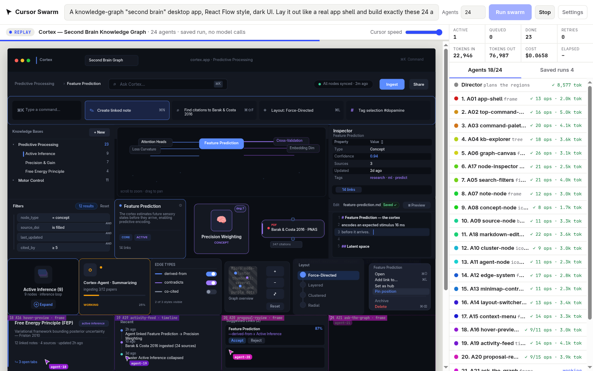

# Cursor Swarm

Watch a swarm of real LLM agents build a UI live, one cursor per agent.



You describe a page. A director model splits it into regions, then one agent per
region draws its part at the same time. Every box, label and button a cursor
draws is a line a model wrote. Nothing is a pre-recorded animation unless you
pick the mock driver or replay a saved run, and both are labelled on screen.

## Try it without any API key

```bash
git clone https://github.com/kyl-er/cursor-swarm
cd cursor-swarm
node server.mjs
```

Open http://127.0.0.1:8981, go to **Saved runs** and press **Replay** on the
bundled run. That replays a real 24-agent session from disk with no model calls.

Needs Node 20 or newer. There are no dependencies to install.

## Run it live

Live runs drive the [pi](https://github.com/badlogic/pi-mono) coding agent CLI,
one `pi --mode rpc` process per agent with tools switched off.

1. Install `pi` and sign in to at least one provider.
2. Start the server and open the page.
3. Type what to build, set the agent count and press **Run swarm**.
4. Under **Settings**, the worker and director models are any `provider/model`
   that `pi --list-models` shows.

A fast, cheap model works well for the workers. A 24-agent run on
`cerebras/qwen-3.8-27b` cost about $0.07 when this was written.

## How it works

```
prompt ─▶ director (1 call) ─▶ regions + style guide + one ReUI component each
                                   │
                 governor: max parallel, max launches per minute
                                   │
              ┌────────────┬───────┴────┬────────────┐
           agent 1      agent 2      agent 3   …  agent N     (stateless, no tools)
              │            │            │            │
              └── JSONL edit ops, streamed ──────────┘
                                   │
            browser: one cursor per agent applies each op to the page
```

- **Director.** One call returns a row and column plan. The server turns it
  into regions that cannot overlap, so agents never collide.
- **Workers.** Each gets only its own brief and the shared style guide, and
  streams small JSON operations: `box`, `text`, `button`, `image`, `update`.
  Context stays small and is never re-sent, which is what keeps runs cheap.
- **Governor.** Caps how many agents call the model at once and how many
  launch per minute, backs off on rate limits, and stops the whole run on
  payment or auth errors instead of retrying.
- **Design system.** If a [ReUI](https://reui.io) MCP server is configured in
  `~/.config/mcp/mcp.json`, the server fetches its component catalog once per
  run and the director assigns a real component to each region. Without it, a
  small built-in list is used.
- **Sessions.** Every run is written to `sessions/<id>.jsonl` as it happens.
  Replay re-runs the saved operations through the same cursor animation.

## What is and is not real

- The edits are real model output. The cursor movement between them is
  animation: an agent emits "draw a box here" and its cursor travels there and
  draws it.
- Agents draw with a small set of primitives on a canvas. The result is a
  mock-up, not a working React app.
- This is not pixel-level computer use. No agent controls a real mouse.

## Files

| File | What it does |
| --- | --- |
| `server.mjs` | HTTP server, director, workers, governor, session storage |
| `reui.mjs` | One-call ReUI catalog fetch with cache and fallback |
| `public/index.html` | The whole UI: canvas, cursors, agent list, saved runs |
| `run.sh` | `start`, `stop`, `status` for a background server |
| `sessions/` | Saved runs. One demo run is included |

The server only listens on `127.0.0.1` and rejects requests from other origins,
because it can start agent processes.

## Credits

The look of many cursors building a page was popularised by Joel Califa's
[Swarm](https://califa.github.io/swarm-site/) and the Swarm Rebuild extension,
which are scripted animations. This project shares no code with them. It exists
to do the same thing with real agents.

## Licence

MIT
